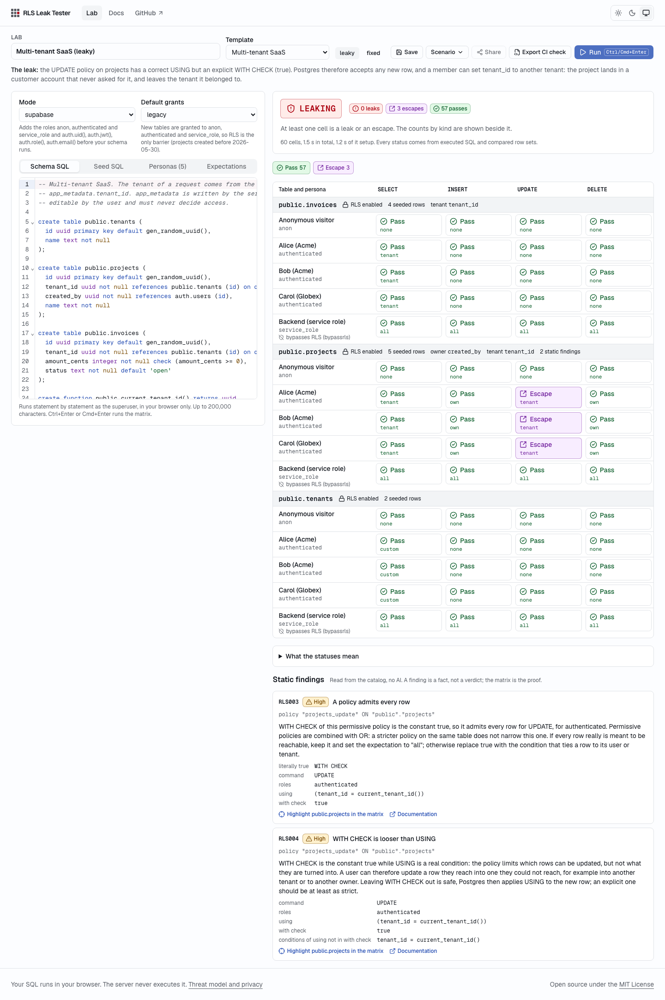

# RLS Leak Tester

Test whether your Postgres and Supabase row-level security policies actually isolate users and
tenants, in your browser, with a CI-ready proof.

> **The core principle: deterministic verdicts, the AI only explains.** Every pass, leak and
> verdict comes from executing SQL and comparing row sets. The language model never decides whether
> something is a leak and never produces a verdict. It explains a failure the engine already
> proved, and it may propose a fix; that fix is labelled "Verified fix" only after the matrix was
> re-run with it, the failing cells pass and nothing else regressed.

<picture>
  <source media="(prefers-color-scheme: dark)" srcset="docs/screenshots/lab-leaking.dark.png">
  
</picture>

## What it does

You paste a schema with RLS policies (Supabase style or plain Postgres), seed a few rows, and
describe a few personas: a database role plus JWT claims. RLS Leak Tester then:

1. starts a fresh Postgres **inside your browser tab** (PGlite, PostgreSQL 18 compiled to
   WebAssembly, in a Web Worker) and loads your schema and seed;
2. runs a persona x table x operation matrix. Every probe runs under the persona's role and claims
   inside a transaction that is rolled back, never as a superuser, a table owner or a `BYPASSRLS`
   role. Probes: `SELECT`, `UPDATE` and `DELETE` reach, `UPDATE` scope escape (moving a row into
   another tenant or to another owner), and `INSERT` per scope class;
3. compares the rows each persona reached with the rows it should reach and classifies every cell:
   `pass`, `leak`, `escape`, `overblock`, `inconclusive` or `skipped`. The verdict is `ISOLATED`,
   `LEAKING` or `NOT PROVEN`, and the same scenario always gives byte-identical result JSON;
4. runs nine static checks on the catalog (`RLS001` to `RLS009`: RLS not enabled, `USING (true)`,
   a `WITH CHECK` looser than `USING`, trust in `user_metadata`, `SECURITY DEFINER` without a
   pinned `search_path`, views without `security_invoker`, and more), each with a documentation
   link;
5. exports the same checks as a CI job: `rls-isolation.test.sql` (plain SQL, no pgTAP, built from
   the runner's own probe builders) and a GitHub Actions workflow that runs it with `psql` against a
   Postgres service, so isolation is proven on every push;
6. optionally explains a failing cell with an LLM and verifies the proposed fix by re-running the
   matrix (see the principle above).

Four templates ship in a leaky and a fixed variant: multi-tenant SaaS, team workspace, todos with
sharing, and the app's **own** `scenarios` table from `supabase/migrations/`, so the tool verifies
itself. Scenarios are saved in the browser's local storage, can be exported and imported as JSON,
and can be shared by link when Supabase is configured.

## Quick start (zero configuration)

Requirements: Node.js 22.22.2 or later (developed on Node 26, CI runs Node 24) and npm. No
environment variable, no database, no account and no Docker are needed for the lab.

```sh
npm ci
npm run dev
```

Open <http://localhost:3000/lab>, pick a template, keep the **leaky** variant and press **Run**.
You get `LEAKING` with the failing cells; click a cell for the probe SQL and the leaked keys.
Switch to **fixed**, run again, and the verdict is `ISOLATED`. **Export CI check** downloads the
files for your repository. `/docs` in the running app explains the probes, the statuses, the static
checks, the threat model and the limits.

The first visit to the lab downloads about 17 MB of WebAssembly and data; the start page loads
none of it.

## Optional capabilities

With nothing configured everything above works. Each capability below switches on when its
variables are present and shows a calm notice when they are absent. For local use, copy
`.env.example` to `.env.local` and fill in only what you need; `src/lib/config` validates every
value at startup and is the only reader of the environment. `GET /api/health` reports which
features are on, as booleans only:

```sh
curl -s http://localhost:3000/api/health
# {"status":"ok","buildId":"dev","features":{"explain":false,"redis":false,"supabase":false}}
```

| Capability                        | Variables                                                                                       | Notes                                                                                                                                                                                                                                                                                   |
| --------------------------------- | ----------------------------------------------------------------------------------------------- | --------------------------------------------------------------------------------------------------------------------------------------------------------------------------------------------------------------------------------------------------------------------------------------- |
| **Explain** (AI explanation, fix) | `ANTHROPIC_API_KEY`, optional `ANTHROPIC_MODEL`                                                 | The default model id is defined once, in `src/lib/ai/model.ts`. **In production (`NODE_ENV=production`: `next start`, Vercel production and preview) Explain also requires `REDIS_URL`**; without it `/api/explain` stays disabled, because an unmetered model endpoint is a cost risk. |
| **Redis**                         | `REDIS_URL` (`redis://` locally, `rediss://` managed)                                           | Backs the rate limiter (atomic Lua sliding window), the explanation cache (7 days), the single-flight lock and the shared-scenario cache. Locally: `docker compose up -d redis` and `REDIS_URL=redis://localhost:6379`. Without it, in-memory adapters are used, per process.           |
| **Sharing** and GitHub sign-in    | `NEXT_PUBLIC_SUPABASE_URL`, `NEXT_PUBLIC_SUPABASE_ANON_KEY`, recommended `NEXT_PUBLIC_SITE_URL` | Needs a Supabase project with `supabase/migrations/` applied and the GitHub provider enabled; see [docs/DEPLOY.md](docs/DEPLOY.md). Without it Share is disabled with an explanation and scenarios stay in local storage. `SUPABASE_SERVICE_ROLE_KEY` is not used by the application.   |

If Redis is configured but unreachable, `/api/explain` and scenario writes fail closed with `503`;
the lab itself runs in the browser and is unaffected.

## Quality gate

`npm run quality` is the single local gate. It runs these stages in order, stops at the first one
that fails, and prints which stage failed and how to run it alone:

1. Sonar preflight (server `UP`, `.env.sonar` present), so a missing server fails in seconds
2. `npm run format:check`
3. `npm run lint` (ESLint with the architecture boundaries as errors, zero warnings allowed)
4. `npm run typecheck`
5. `npm run rules` (validates `rules.yaml` and runs its script checks)
6. `npm run test:coverage` (Vitest; starts the `redis` compose service when Docker is available so
   the Redis contract suite also runs on a real Redis; at least 80 percent lines and branches)
7. `npm run build`
8. Playwright against the production build, with the strict Content-Security-Policy active
9. `npm run sonar`: the SonarQube scan, which waits for the quality gate and fails when it fails

SonarQube runs locally from `docker-compose.yml`; nothing talks to an external service. It needs
roughly 2 to 3 GB of memory.

```sh
docker compose up -d --wait sonarqube   # first start takes 2 to 4 minutes
npm run sonar:bootstrap                 # idempotent; writes the git-ignored .env.sonar
npm run quality
```

The bootstrap rotates the default admin password, creates the project `postgres-rls-leak-tester`
and an analysis token, and creates the gate **RLS Leak Tester** from the thresholds in
`rules.yaml`. Its conditions apply to overall code **and** to new code: coverage at least 80
percent, duplicated lines at most 3 percent, reliability, security and maintainability rating A,
security hotspots reviewed 100 percent, zero blocker and zero critical issues (called "high" on a
server in MQR mode). Details, the web API calls used and how to read results:
[scripts/sonar/README.md](scripts/sonar/README.md). Findings are fixed in the code; a suspected
false positive stays open and is documented in [docs/sonar-triage.md](docs/sonar-triage.md).

On a machine without Docker, `npm run quality -- --no-sonar` runs every other stage and says in its
last line that the gate was **not** fully run. No test, lint rule, threshold or exclusion is ever
loosened to get green, and every exclusion of every tool is listed in `rules.yaml` with its reason.

CI (`.github/workflows/ci.yml`) runs the same promises as five jobs: static checks, unit tests
with a Redis service, Playwright, the self-isolation proof against a real Postgres service, and a
Sonar job that skips cleanly when no token is configured, so a fresh fork is green.

## Testing

| Command                                                                      | What it runs                                                                                                                              |
| ---------------------------------------------------------------------------- | ----------------------------------------------------------------------------------------------------------------------------------------- |
| `npm test`                                                                   | Vitest: unit tests beside the code, integration suites under `tests/` against real PGlite. No network: a guard blocks non-loopback calls. |
| `npm run test:coverage`                                                      | The same with coverage and the 80 percent thresholds                                                                                      |
| `REDIS_URL=redis://127.0.0.1:6379 npm test`                                  | Adds the Redis adapter contract suite on a real Redis (`docker compose up -d redis` first)                                                |
| `npm run e2e`                                                                | Production build, then Playwright (Chromium) including the accessibility scans. First time: `npx playwright install chromium`             |
| `npm run e2e:dev`                                                            | Playwright against `next dev`                                                                                                             |
| `npm run lint`, `npm run typecheck`, `npm run rules`, `npm run format:check` | The static checks                                                                                                                         |
| `sh scripts/verify-export-postgres.sh`                                       | Executes the exported CI proof of every template against real Postgres in Docker: passes on fixed, fails on leaky                         |
| `sh scripts/self-isolation/verify-postgres.sh`                               | The app's own migration plus its exported proof against real Postgres in Docker                                                           |

What the suites pin down: golden snapshots of the full result JSON per template variant (under
`tests/golden/`), exact failing cells per leaky variant, bypass guards (a test in which forgetting
the role switch would make a leaky scenario pass), a positive and a negative fixture per static
check, the export executed against both variants, one contract suite for the Redis and the
in-memory adapters including concurrency, and the API handlers with a mocked model. Tests never
call a real model unless `RUN_LIVE_AI_TESTS=1` and a key are both set.

## Architecture

```
src/app/            routes and API handlers (thin; no business logic)
src/components/     UI (shadcn/ui, CodeMirror editors, the matrix grid)
src/lib/scenario/   scenario types, zod schemas, templates, defaults, SQL splitter
src/lib/engine/     SqlEngine port, PGlite adapter, worker client, Supabase shim
src/lib/runner/     setup, introspection, ground truth, probe builders, classifier, verdict
src/lib/checks/     static checks RLS001..RLS009
src/lib/export/     the CI proof: SQL test and workflow generators (share the probe builders)
src/lib/redis/      ports with a Redis and an in-memory adapter each: limiter, cache, lock
src/lib/ai/         model id, prompt, schemas, the explain route logic
src/lib/store/      ScenarioStore port: localStorage adapter, Supabase adapter, server side
src/lib/security/   Content-Security-Policy and headers, the client address for rate limits
src/lib/config/     typed, validated environment access (the only reader of process.env)
supabase/migrations SQL-first schema and policies of the optional store
tests/, e2e/        integration suites and fixtures; Playwright
scripts/            rules check, quality gate, SonarQube bootstrap, hooks, export verification
```

`runner`, `checks`, `export` and `scenario` are pure TypeScript: no React, no `next/*`, no network.
They run identically in the browser worker and in Node tests. The boundaries are ESLint errors and
script checks, not conventions.

- [CLAUDE.md](CLAUDE.md): the working guide for this repository (commands, the full architecture
  map, traps that cost time once)
- [rules.yaml](rules.yaml): principles, rules with their enforcers, thresholds, every exclusion
  with its reason, forbidden actions
- [docs/adr/](docs/adr/): one decision record per design and per deviation from the build brief,
  with the evidence behind it
- [docs/PROGRESS.md](docs/PROGRESS.md): what was built and what was verified, per phase

## Privacy and threat model

Your SQL executes only in your own browser tab, in sandboxed WebAssembly; the server never executes
user SQL, and nothing leaves the browser while you edit or run. Data leaves only when you ask:
**Explain** sends a capped, validated slice for one failing cell (table DDL, policies, role and
claims, expected and actual keys; never the seed data), and **Share** stores the scenario in the
deployment's Supabase project. Opening someone else's shared scenario runs their SQL in your tab,
where it can burn CPU and nothing else, which is what the worker timeouts are for.

The full threat model, the prompt-injection stance, rate limiting, headers and how to report a
vulnerability are in [SECURITY.md](SECURITY.md); the user-facing version is the `/docs` page of the
running app (section "Threat model").

## Limits of version 1

- Tables without a primary key are skipped; there is no fallback to `ctid`.
- PGlite is PostgreSQL 18 with no extensions loaded. A schema that needs `create extension` has to
  be reduced to the tables and policies under test. `gen_random_uuid()` is built in.
- `statement_timeout` is not enforced by PGlite. The only timeout is terminating the worker, after
  which schema and seed are replayed; the probe is reported as timed out (`inconclusive`).
- The verdict covers the personas, rows and expectations you describe. Seed at least two users and
  two tenants, or there is nothing to leak to.
- Static checks read the catalog, not intent: a helper function that reads `user_metadata` in its
  body is not seen by `RLS005`, and a tautology such as `(1 = 1)` is not evaluated by `RLS003`. The
  matrix finds what they cannot.
- A seed that uses `gen_random_uuid()` or `now()` for keys or for owner and tenant columns gives
  different keys in every run. Probe inserts advance sequences although the rows are rolled back.
- Supabase mode models roles, grants and the `auth` functions. It does not model PostgREST,
  Storage policies or Realtime.
- Rate limits are per address and, when signed in, per user, under the assumption of exactly one
  trusted proxy in front of the app (Vercel, or your own reverse proxy). `next start` exposed
  directly to the internet is not a supported public deployment. Callers can rotate inside an IPv6
  /64. Reading a shared scenario by slug is not rate limited.
- The anon key is public, so a signed-in user can call PostgREST directly. RLS and the check
  constraints hold there, but the API's rate limit, slug generator and scenario validation do not
  apply, and there is no per-user row quota. The owner id of a **public** scenario is readable
  through the table.
- Not verified by the build, because each needs an account: a live Anthropic stream, a real
  Supabase project, the exported workflow on GitHub's runners, and `TIME` inside Lua on a managed
  Redis (see [docs/DEPLOY.md](docs/DEPLOY.md)).
- Not in version 1 by design: payments, teams and organisations, server-side execution of user
  SQL, databases other than Postgres, a visual policy builder, real-time collaboration, i18n.

## Deploying

[docs/DEPLOY.md](docs/DEPLOY.md) is the owner's ordered checklist: Vercel project, environment
variables, custom domain and DNS, Supabase, Redis, optional SonarQube Cloud, and the smoke checks
after the first deployment.

## Suggested GitHub topics

For the repository owner to add under "About": `postgres`, `supabase`, `row-level-security`,
`multi-tenancy`, `security-testing`, `pglite`, `nextjs`.

## License

[MIT](LICENSE), copyright 2026 Mile Stanislavov.
